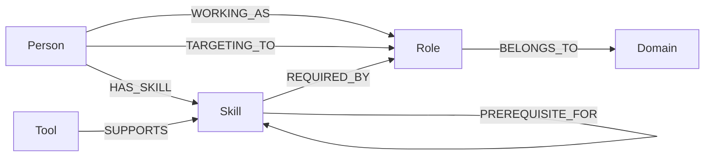
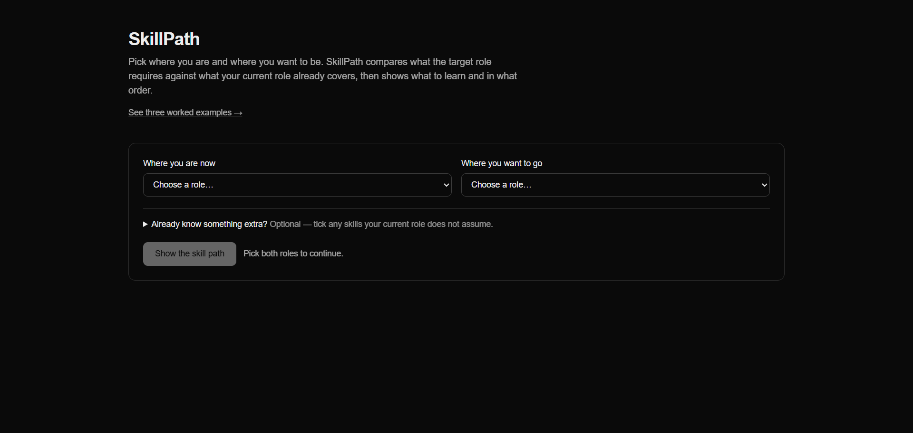
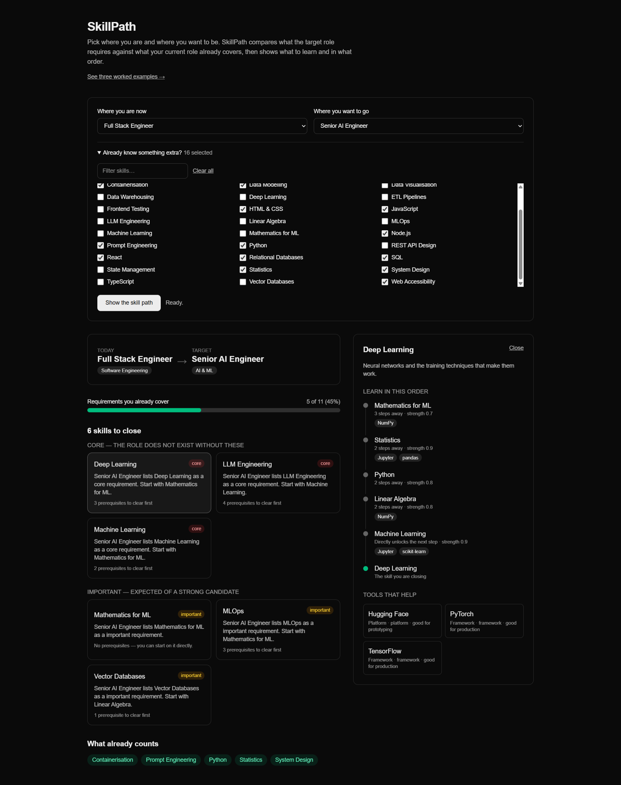
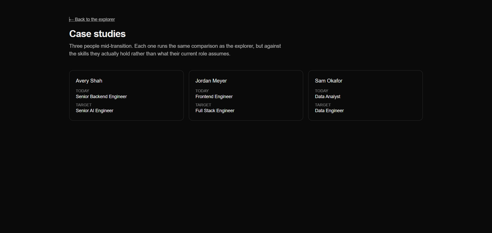

# SkillPath

> Graph-powered career skill gap analysis using CognoDB and openCypher.

## Overview

SkillPath helps a technology professional understand the skill path between their current role and a target role.

The user selects:

- Current role
- Target role
- Current skills

The application traverses a CognoDB graph to determine:

- Skills already aligned with the target.
- Missing target-role skills.
- Prerequisite skills.
- Tools that support those skills.

Graph-powered career skill gap analysis. Pick where you are and where you want to be; SkillPath compares the target role's requirements against the skills the current role already covers, then walks the prerequisite graph to say what to learn and in what order.

The calculation is graph traversal and arithmetic. No model is involved, so the same graph always produces the same screen.

for more information you may visit [Documentation](./docs/01-INDEX.md)

### Two flows, one traversal

|          | Explorer (`/`)                                              | Case studies (`/case-studies`)                  |
| -------- | ----------------------------------------------------------- | ----------------------------------------------- |
| Input    | Two role ids, plus any skills you tick                      | One person id                                   |
| Baseline | What the**current role** requires, **plus** what you ticked | What the**person** actually holds (`HAS_SKILL`) |
| Answers  | Any of the 10 × 10 role pairs                               | The three seeded transitions                    |

A job title is a floor, not a ceiling. Deriving the baseline from the current role alone would tell a Data Analyst who already writes Python to go learn Python, so the explorer offers an optional skills picker and unions it into the baseline. Ticking Python on Data Analyst → Data Engineer moves coverage from 1/9 to 2/9 and drops Python out of the gap list _and_ out of the prerequisite chain under ETL Pipelines — one exclusion, applied at both levels.

Both subtract a baseline from the target role's `REQUIRED_BY` set and traverse `PREREQUISITE_FOR` for whatever is left, so they share the gap query shape, the mapper, and the whole UI. Only the baseline differs.

The explorer is the product: it works for a visitor the graph has never heard of. The case studies exist because the assignment specifies a skill path service keyed on `personId` — they keep that flow real and show what the `HAS_SKILL` edge buys you. Compare Frontend Engineer → Full Stack Engineer in the explorer with Jordan Meyer's page: same pair, different gaps, because Jordan knows things the role does not assume.

## Setup

```bash
npm install
cp .env.example .env.local     # already filled in for the local database
docker compose up -d           # CognoDB stand-in on bolt://localhost:7687
npm run seed
npm run dev
```

Open http://localhost:3000. `GET /api/health` answers whether this process can reach the graph.

### CognoDB Setup

1. Create a CognoDB Cloud account at the console.
2. Create a free `c0` instance.
3. Save the generated password immediately.
4. Copy the Bolt URI.
5. Put the URI, username, and password into local environment variables.
6. Run the seed script.
7. Start the application.

### Pointing at CognoDB

Nothing in the code names a vendor. Change three environment variables and restart:

```
COGNODB_URI=bolt+s://<instance-id>.databases.cognodb.cloud
COGNODB_USERNAME=<user>
COGNODB_PASSWORD=<password>
```

Credentials are read on the server only, through `src/server/config/env.ts`. `src/server/graph/driver.ts` imports `server-only`, so any accidental import from a client component fails the build rather than shipping a URI to the browser.

## Data Model



### Relationship Properties

| Relationship       | Properties            |
| ------------------ | --------------------- |
| `WORKING_AS`       | `since`               |
| `TARGETING_TO`     | —                     |
| `HAS_SKILL`        | `proficiency`         |
| `BELONGS_TO`       | —                     |
| `REQUIRED_BY`      | `importance`          |
| `PREREQUISITE_FOR` | `strength`            |
| `SUPPORTS`         | `type`, `suitableFor` |

```
Person -[:WORKING_AS {since}]-> Role
Person -[:TARGETING_TO]-> Role
Person -[:HAS_SKILL {proficiency}]-> Skill
Role   -[:BELONGS_TO]-> Domain
Skill  -[:REQUIRED_BY {importance}]-> Role
Skill  -[:PREREQUISITE_FOR {strength}]-> Skill
Tool   -[:SUPPORTS {type, suitableFor}]-> Skill
```

Five node types, seven relationship types. `Domain` groups the role selectors and labels each role on screen.

## Architecture

```text
Browser
  |
  v
Web UI
  |
  v
Application/API Layer
  |
  v
Graph Repository
  |
  v
Official Neo4j Driver
  |
  v
CognoDB (openCypher over Bolt)
```

The repository is organized as a modular monolith so the domain logic, graph access, API, and UI remain clearly separated without introducing distributed-system complexity.

```
src/app/            routes and pages         (HTTP in, JSON or HTML out)
src/components/     UI                       (state machines: loading / ready / empty / error)
src/server/
  api/              request and error shaping
  services/         the calculation          (pure, testable)
  repositories/     the only Cypher          (returns typed objects, never driver records)
  graph/            driver lifecycle and error mapping
  config/           environment validation
src/types/          the shared vocabulary
```

`src/server/repositories/cypher.ts` is the single file containing Cypher. Every statement is parameterized; no user input is ever concatenated into a query.

## Why a graph

The core product questions are about **connections**, not isolated records.

A relational schema can store roles, skills, tools, and join tables, but the most valuable operations require several relationship traversals:

`Person → TARGETING_TO → Role ← REQUIRED_BY ← Skill ← PREREQUISITE_FOR ← Skill ← SUPPORTS ← Tool`

The graph representation makes these relationships first-class and allows multi-hop traversal to be expressed naturally in Cypher.

The graph is particularly useful for:

1. Finding target-role skills.
2. Excluding skills the person already has.
3. Traversing prerequisite chains.
4. Finding tools connected to prerequisite/missing skills.
5. Explaining recommendations through their graph path.

Two questions are awkward in SQL and natural here.

**Prerequisite chains are variable-length.** "What gates Deep Learning, transitively?" is one pattern:

```cypher
MATCH path = (prereq:Skill)-[:PREREQUISITE_FOR*1..3]->(skill:Skill {id: $skillId})
```

In SQL that is a recursive CTE per query. Here the depth is a number in the pattern.

**Gap detection is a negated pattern.** "Required by the target role, and not already covered":

```cypher
MATCH (missing:Skill)-[:REQUIRED_BY]->(target)
WHERE NOT (missing)-[:REQUIRED_BY]->(current)
  AND NOT missing.id IN $haveSkillIds
```

Swap those two lines for `WHERE NOT (p)-[:HAS_SKILL]->(missing)` and the same query answers the case-study question instead. The baseline is one predicate, not a different algorithm.

## Explainability

Every gap card carries a sentence like _"Senior AI Engineer lists Deep Learning as a core requirement. Start with Statistics."_

The service does not write that sentence. It returns the facts behind it — target role title, importance, the deepest unmet prerequisite — as `SkillGap.reason`, and the UI composes the copy. That keeps prose out of the data layer and makes the sentence a rendering concern rather than a query result.

Ordering is explicit everywhere it is visible: gaps by importance then name, prerequisites deepest-first then by strength then name. Nothing depends on the order the database happened to return.

## Seeding

`npm run seed` is idempotent. Every node and relationship is merged on identity only, with properties applied in a following `SET`:

```cypher
MERGE (p)-[h:HAS_SKILL]->(s)
SET h.proficiency = row.proficiency
```

Writing `MERGE (p)-[:HAS_SKILL {proficiency: 3}]->(s)` instead would match on the property, so changing a 3 to a 4 would create a second edge. Run the seed as many times as you like; the counts do not move.

Three seeded people, shown on `/case-studies`:

| Person       | Today                   | Target              | Requirements met |
| ------------ | ----------------------- | ------------------- | ---------------- |
| Avery Shah   | Senior Backend Engineer | Senior AI Engineer  | 3 of 11          |
| Jordan Meyer | Frontend Engineer       | Full Stack Engineer | 5 of 10          |
| Sam Okafor   | Data Analyst            | Data Engineer       | 2 of 9           |

Every one of the 10 roles carries `REQUIRED_BY` edges, not just the six these three people occupy. The explorer accepts any pair, so a role with no requirements would answer with an empty path that reads like a broken screen rather than an honest one.

## Errors

Six codes, one response shape, `{ "error": { "code", "message" } }`:

| Code                   | Status | Means                                      |
| ---------------------- | ------ | ------------------------------------------ |
| `CONFIGURATION_ERROR`  | 500    | Environment variables missing or malformed |
| `DATABASE_UNAVAILABLE` | 503    | Cannot reach the graph                     |
| `QUERY_FAILED`         | 500    | The database rejected the query            |
| `NOT_FOUND`            | 404    | No such person, role, or skill             |
| `VALIDATION_ERROR`     | 400    | Bad route parameter                        |
| `UNKNOWN_ERROR`        | 500    | Anything else                              |

Driver errors, connection URIs, and stack traces are logged on the server and never serialized to the client. The UI keys its copy on the code and only offers _Try again_ where retrying can help.

## Tests

```bash
npm test
```

- `tests/skill-path.service.test.ts` — the gap and coverage calculation, no database.
- `tests/seed-idempotency.test.ts` — runs the seed twice and asserts the graph did not grow. Needs the database running.

## API

| Route                                                          | Returns                                                                                          |
| -------------------------------------------------------------- | ------------------------------------------------------------------------------------------------ |
| `GET /api/health`                                              | `{ status: "ok" }` or an error code                                                              |
| `GET /api/profiles`                                            | Every role, plus the three seeded transitions                                                    |
| `GET /api/skills`                                              | Every skill, for the "what do you already know" picker                                           |
| `GET /api/transitions/:currentRoleId/:targetRoleId?have=id,id` | The skill path between two roles — no person involved.`have` is optional and widens the baseline |
| `GET /api/skill-path/:personId`                                | The same shape for one seeded person: roles, held skills, requirements, matches, gaps, coverage  |
| `GET /api/skills/:skillId`                                     | One skill, its prerequisite chain, and supporting tools                                          |

## Screenshots

following are the screenshots from [LIVE](https://skill-path-production.up.railway.app/)



Skill Gap Explore:


Example Persons:

