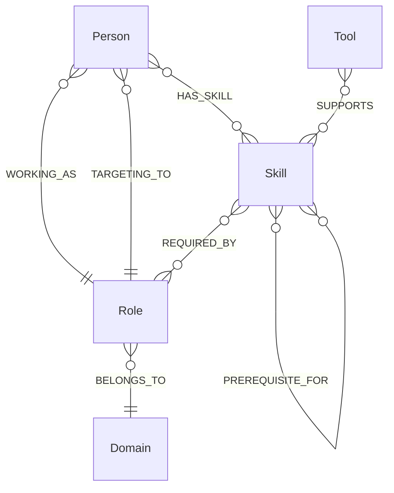

# SkillPath — ERD / Graph Data Model

> This is a graph ERD. Relationships are first-class edges rather than relational foreign keys.

## 1. Diagram



## 2. Node Schemas

### Person

```text
Person {
  id: string
  name: string
}
```

### Role

```text
Role {
  id: string
  title: string
  level: string
}
```

### Domain

```text
Domain {
  id: string
  name: string
}
```

### Skill

```text
Skill {
  id: string
  name: string
  description: string
}
```

### Tool

```text
Tool {
  id: string
  name: string
  category: string
}
```

## 3. Relationships

### WORKING_AS

```text
Person -[:WORKING_AS { since }]-> Role
```

### TARGETING_TO

```text
Person -[:TARGETING_TO]-> Role
```

### HAS_SKILL

```text
Person -[:HAS_SKILL { proficiency }]-> Skill
```

### BELONGS_TO

```text
Role -[:BELONGS_TO]-> Domain
```

### REQUIRED_BY

```text
Skill -[:REQUIRED_BY { importance }]-> Role
```

Allowed importance:
- `core`
- `important`
- `supporting`

### PREREQUISITE_FOR

```text
Skill -[:PREREQUISITE_FOR { strength }]-> Skill
```

`strength` is a numeric value from 0 to 1.

### SUPPORTS

```text
Tool -[:SUPPORTS {
  type,
  suitableFor
}]-> Skill
```

Suggested values:
- `type`: language, IDE, framework, library, platform, practice, database, CLI
- `suitableFor`: beginner, intermediate, advanced, all

## 4. Example Graph

```text
(Person)
  |
  +--WORKING_AS--> (Senior Backend Engineer)
  |
  +--TARGETING_TO--> (Senior AI Engineer)
  |
  +--HAS_SKILL {proficiency: 4}--> (Python)
                                      ^
                                      |
                         REQUIRED_BY {importance: core}
                                      |
                            (Senior AI Engineer)

(Machine Learning)
      |
      +--PREREQUISITE_FOR {strength: .9}--> (Deep Learning)

(scikit-learn)
      |
      +--SUPPORTS {type: library, suitableFor: intermediate}-->
      (Machine Learning)
```

## 5. Why This Model Is Intentionally Small

The assignment evaluates graph modeling judgment. The model avoids entities that are not required for the product's core graph questions.

Not included:
- Project
- Course
- Certification
- Job
- Company
- Learning Resource

Those could be future extensions but are deliberately excluded from the take-home scope.
